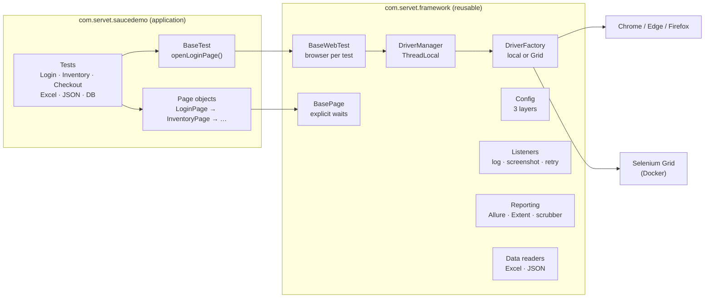
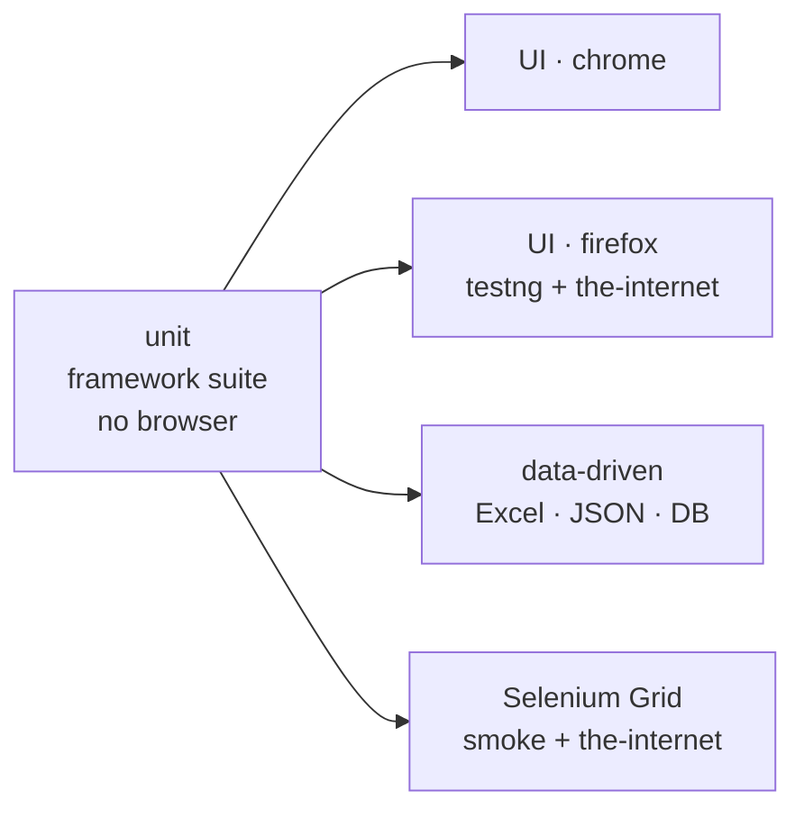

# Web Testing Framework v1 · Selenium 4 + TestNG

[](https://github.com/Albatros46/Web-Testing-Framework-v1/actions/workflows/ui-tests.yml)
      

A reusable UI test framework: the generic part (`com.servet.framework`) knows nothing about the application under test; the application part (`com.servet.saucedemo`) contains only page objects and tests.
The same tests run on a developer machine, in GitHub Actions and on a Selenium Grid in Docker — selected by one switch: `-Denv=local | ci | grid`.

Part of my 52-week QA Automation roadmap — **Week 12**, the end of phase 2 (web UI automation). It brings together weeks 6–11, built step by step in [saucedemo-selenium-pom](https://github.com/Albatros46/saucedemo-selenium-pom), and adds what a team framework needs: environment profiles, Selenium Grid, logging and CI.

## Architecture



```
src/main/java/com/servet/framework/      FRAMEWORK — reusable, no app knowledge
├── config/Config                        config.properties → config-{env}.properties → -Dkey=value
├── driver/DriverFactory                 Chrome / Edge / Firefox, local or RemoteWebDriver, start retry
├── driver/DriverManager                 ThreadLocal<WebDriver>: one browser per thread
├── base/BaseWebTest                     fresh browser per test (@BeforeMethod / @AfterMethod)
├── pages/BasePage                       wait → click / type / read
├── listeners/                           TestListener (log + screenshot) · RetryAnalyzer · RetryTransformer
│                                        ExtentReportListener · AllureEnvironmentListener · MaskedParameterScrubber
├── reporting/ReportParameters           hide a parameter in Allure
└── data/                                ExcelReader (Apache POI) · JsonReader (Jackson)

src/main/java/com/servet/saucedemo/pages/   APPLICATION — page objects only
src/test/java/com/servet/saucedemo/         APPLICATION — BaseTest, tests, test data, DataProviders
src/main/java/com/servet/theinternet/pages/ SECOND APPLICATION (v1.1.0) — 12 page objects
src/test/java/com/servet/theinternet/       SECOND APPLICATION — 16 tests, no own BaseTest
src/test/java/com/servet/framework/         framework unit tests (no browser)
```

## Run

| Command | What runs |
|---|---|
| `mvn test` | 14 UI tests in Chrome, window visible (`env=local`) |
| `mvn test -Denv=ci` | same, headless, longer timeouts — what GitHub Actions runs |
| `docker compose up -d` then `mvn test -Denv=grid` | browsers run in a Selenium Grid container |
| `mvn test -Dsuite=framework` | 9 framework unit tests, no browser, a few seconds |
| `mvn test -Dsuite=smoke` | 4 critical flows |
| `mvn test -Dsuite=datadriven` | 20 tests driven by Excel, JSON and an H2 database |
| `mvn test -Dsuite=parallel` | 14 tests in 4 threads |
| `mvn test -Dsuite=cross-browser` | smoke tests in Chrome, Edge and Firefox at the same time |
| `mvn test -Dsuite=the-internet` | 16 hard scenarios on the-internet.herokuapp.com (second application) |
| `mvn test -Dsuite=demo` | listener demo: a real bug with screenshot + a flaky test passing on retry (red on purpose) |
| `mvn test -Dbrowser=firefox -DretryCount=0` | override any single setting |
| `mvn test -DlogLevel=DEBUG` | more log detail |
| `mvn allure:serve` | build the Allure report and open it |

In PowerShell, quote parameters that contain dots or `#`: `mvn test "-Dtest=LoginTest#validLoginOpensProductsPage"`.

## Configuration: three layers

```
config.properties          defaults for every environment
  └─ config-{env}.properties   environment profile, chosen with -Denv (default: local)
       └─ -Dkey=value              one setting, from the command line
```

| Setting | `local` | `ci` | `grid` |
|---|---|---|---|
| `headless` | false | true | true |
| `explicitWaitSeconds` | 10 | 15 | 15 |
| `pageLoadTimeoutSeconds` | 30 | 60 | 30 |
| `gridUrl` | — (local browser) | — | `http://localhost:4444` |

- A typo in the profile name fails fast: `-Denv=prdo` → `config-prdo.properties bulunamadı`, no test runs against the wrong defaults.
- A blank value means "not set", so `-DgridUrl=` sends a `grid` run back to a local browser.
- The active profile and Grid URL are written into both reports (Allure *Environment*, Extent *System info*).

## Selenium Grid in Docker

```bash
docker compose up -d        # Grid + Chrome 155 in one container, http://localhost:4444/ui
mvn test -Denv=grid -Dsuite=parallel
docker compose down
```

`DriverFactory` builds the same `ChromeOptions` either way and passes them to `ChromeDriver` or to `RemoteWebDriver`. Tests, pages and listeners do not change — screenshots on failure work on the Grid too. Watch the browser live at `http://localhost:7900` (noVNC, password `secret`).

Verified in CI, where the Grid runs as a service container — every browser was opened on the Grid, not on the runner's own Chrome:

```
DriverFactory - Starting chrome on Grid http://localhost:4444 (headless=true)
TestListener  - PASS   CheckoutTest.completePurchase (1543 ms)
TestListener  - DONE   <Smoke>: 4 passed, 0 failed, 0 skipped
```

Locally the Grid could not be started yet: Docker Desktop on my machine failed with an `input/output error` in its image store while pulling the image. The CI run above is the proof that the Grid setup works.

## Continuous integration (GitHub Actions)

`.github/workflows/ui-tests.yml` runs on every push and pull request:



- The cheap job runs first; if the framework itself is broken, no browser job starts.
- The Grid job starts `selenium/standalone-chrome` as a **service container**, waits until `/status` reports ready, then runs with `-Denv=grid`.
- Every job uploads Allure results, the Extent report, screenshots, the log file and Surefire reports as an artifact (14 days), also when tests fail.
- `SAUCE_PASSWORD` comes from a repository secret when set; otherwise the public demo password is used.

First green run ([#2](https://github.com/Albatros46/Web-Testing-Framework-v1/actions/runs/40506583902)):

| Job | Tests | Test step | Job total |
|---|---|---|---|
| Framework unit tests | 9 | 22 s | 28 s |
| UI · chrome | 14 | 52 s | 63 s |
| UI · firefox | 14 | 104 s | 116 s |
| Data-driven | 20 | 44 s | 55 s |
| Selenium Grid | 4 | 21 s | 58 s (incl. 26 s container start) |

Run #1 never started: a one-line `run:` contained `"ready": ?true`, and YAML read `: ` as a new key. Fix: a block scalar (`run: |`). Since then the workflow file is validated locally with PyYAML before pushing.

## Logging

The framework uses only the SLF4J API; the test side chooses Logback (`src/test/resources/logback-test.xml`). Every line carries the thread name, so parallel runs stay readable:

```
13:44:37.751 INFO  [TestNG-test-Parallel UI Tests-1] DriverFactory - Starting chrome locally (headless=true)
13:44:37.751 INFO  [TestNG-test-Parallel UI Tests-2] DriverFactory - Starting chrome locally (headless=true)
13:44:37.751 INFO  [TestNG-test-Parallel UI Tests-3] DriverFactory - Starting chrome locally (headless=true)
13:44:37.751 INFO  [TestNG-test-Parallel UI Tests-4] DriverFactory - Starting chrome locally (headless=true)
13:44:45.212 INFO  [TestNG-test-Parallel UI Tests-2] TestListener - START  LoginTest.lockedOutUserSeesError
13:44:45.212 INFO  [TestNG-test-Parallel UI Tests-3] TestListener - START  LoginTest.logoutReturnsToLoginPage
```

Output goes to the console and to `target/logs/test-run.log`. Third-party libraries log at `WARN` only; Apache POI's Log4j output is routed into the same place by `log4j-to-slf4j`.
Log messages are plain ASCII on purpose: the Windows console turned `▶ ✔` and Turkish characters into `?`.

## Adding a page and a test

1. **Page** in `com.servet.saucedemo.pages`, extending `BasePage`. Locators are private constants; each action returns the next page:

   ```java
   public class ProductPage extends BasePage {
       private static final By ADD_TO_CART = By.cssSelector("[data-test^='add-to-cart']");

       public ProductPage(WebDriver driver) { super(driver); }

       @Step("Add the product to the cart")
       public ProductPage addToCart() { click(ADD_TO_CART); return this; }
   }
   ```

2. **Test** extending `BaseTest` — a fresh browser is already there:

   ```java
   public class ProductTest extends BaseTest {
       @Test(groups = "regression")
       public void productCanBeAddedFromDetailPage() {
           openLoginPage().loginAs(STANDARD, PASSWORD) /* … */;
       }
   }
   ```

3. Add the class to a suite in `src/test/resources/suites/`. Logging, screenshots, retry and both reports come from the listeners — no extra code.

To test a **different application**, keep `com.servet.framework` and write a new `pages` package — done for the-internet in v1.1.0, see below.

## A second application: the-internet (v1.1.0)

To prove that the framework is really reusable, v1.1.0 adds a second application, [the-internet.herokuapp.com](https://the-internet.herokuapp.com) — a site full of scenarios that are known to be hard to automate. It completes **Week 11** of the roadmap.

- **Framework changes: one.** `DriverFactory` gives `RemoteWebDriver` a `LocalFileDetector`, so a file upload also works on the Grid (the file is on the test machine, the browser in a container).
- The tests extend the framework's `BaseWebTest` directly — this application does not even need its own `BaseTest`.
- `com.servet.theinternet` imports nothing from `com.servet.saucedemo`, and the framework imports neither.

| Scenario | How | Page |
|---|---|---|
| JS alert · confirm · prompt | `wait.until(alertIsPresent())`, `accept()` / `dismiss()` / `sendKeys()` | `AlertsPage` |
| Nested frames | `frameToBeAvailableAndSwitchToIt`, always back to `defaultContent()` in `finally` | `NestedFramesPage` |
| New window | window handles, `numberOfWindowsToBe(2)`, close and switch back | `WindowsPage` |
| File upload | `sendKeys(path)` on `input[type=file]` with a temp file created by the test | `UploadPage` |
| Element hidden / added later | the same explicit wait for both; the test first checks *which* case it is | `DynamicLoadingPage` |
| Checkbox removed · input enabled | `invisibilityOfElementLocated`, `elementToBeClickable` | `DynamicControlsPage` |
| Hover · right-click | `Actions.moveToElement`, `Actions.contextClick` + alert | `HoversPage`, `ContextMenuPage` |
| HTML5 drag and drop | HTML5 drag events via JavaScript (see measurement below) | `DragAndDropPage` |
| Shadow DOM | `getShadowRoot()`; the test also checks that a normal CSS search does **not** reach inside | `ShadowDomPage` |
| Broken images | `naturalWidth === 0` in the browser **and** the HTTP status of every image (404 / 200) | `BrokenImagesPage` |
| Dropdown | `Select.selectByVisibleText` | `DropdownPage` |

Result: **16/16 in Chrome, Edge and Firefox**, also with retry turned off (`-DretryCount=0`).
In CI ([run #4](https://github.com/Albatros46/Web-Testing-Framework-v1/actions/runs/40860170072)): 16/16 in Chrome, 16/16 in Firefox, and **16/16 on the Selenium Grid — including the file upload** (`PASS UploadTest.uploadsFile`), which proves the `LocalFileDetector` change. All 7 jobs green.

### Measured: does `Actions.dragAndDrop` work with HTML5 drag and drop?

A common claim is that Selenium's mouse actions cannot do HTML5 drag and drop. Measured with Selenium 4.51:

| Browser | `Actions.dragAndDrop` | HTML5 drag events via JavaScript |
|---|---|---|
| Chrome | ✅ columns swap | ✅ |
| Edge | ✅ columns swap | ✅ |
| Firefox | ❌ nothing happens | ✅ |

So the claim is out of date for Chromium but still true for Firefox. The test uses the JavaScript way because it works in all three.

### A real timing bug found by Firefox

In Firefox, `newWindowIsReadAndClosed` failed — also on retry: the new window's title was read as `""`. Firefox finishes the switch to the new window before the page has loaded; in Chrome the test only passed by luck. Fix: wait for the content, then for a non-empty title. A retry would never have fixed this, which is exactly why a test that fails twice the same way has to be looked at, not re-run.

## Design rules

| Rule | Why |
|---|---|
| Framework code never imports application code | The framework can be reused; the dependency goes one way only. |
| Locators live only in page classes | When the UI changes, one place is updated. |
| Explicit waits only, implicit wait = 0 | Mixing both makes wait times unpredictable. No `Thread.sleep()`. |
| One browser per test, kept in a `ThreadLocal` | Tests can run in parallel without sharing a browser. |
| Retry only browser start-up automatically; test retry is visible | A retried test shows up as *skipped + passed* and must be investigated. |
| No secrets in test data or reports | `{{password}}` placeholder + `MaskedParameterScrubber` (see [Week 11](https://github.com/Albatros46/saucedemo-selenium-pom#keeping-the-password-out-of-every-report)). |

## Tests (55)

| Suite | Tests | Browser |
|---|---|---|
| `framework` | 9 — `ConfigTest` (5) · `DataReadersTest` (4) | none |
| `testng` | 14 — `LoginTest` · `InventoryTest` · `CheckoutTest` | yes |
| `datadriven` | 20 — Excel (7) · JSON (3) · H2 database (6) · `DataReadersTest` (4) | yes |
| `the-internet` | 16 — alerts · frames · windows · upload · dynamic content · mouse actions · shadow DOM · broken images · dropdown | yes |

`DataReadersTest` runs in both `framework` and `datadriven`; counted once, that is **55 tests**.

## What I learned
- _TODO: 2–3 sentences in your own words_
